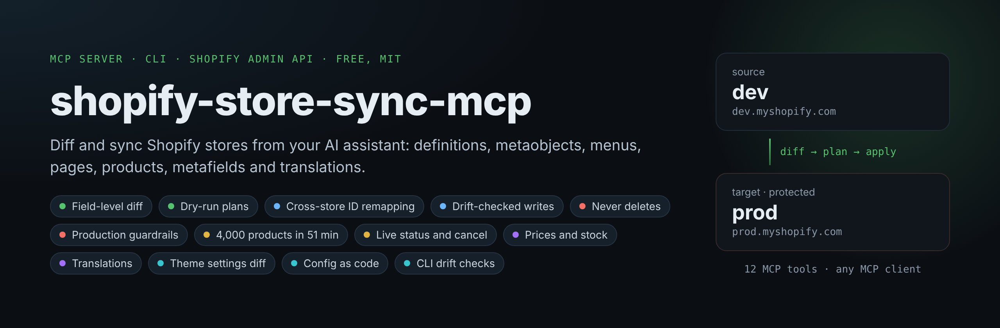
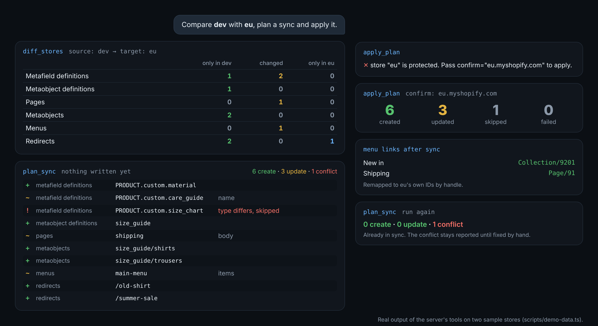
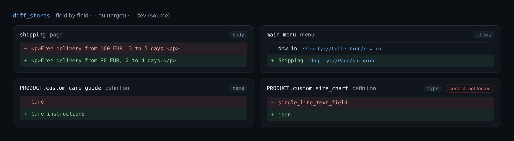
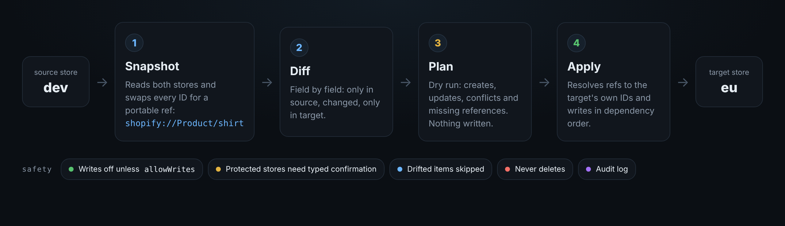
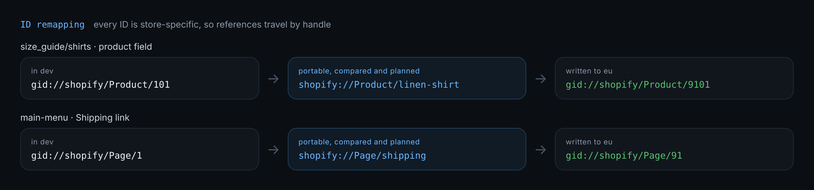

<p align="center">
  
</p>

<p align="center">
  <a href="LICENSE"></a>
  
  
  
</p>

# shopify-store-sync-mcp

**Keep your Shopify stores in sync by asking for it.** Compare a dev store with production, see every difference field by field, review a dry-run plan, then apply it, from Claude, Cursor or any MCP client.

It copies the store setup that usually gets rebuilt by hand: **metafield and metaobject definitions, metaobject entries, pages, navigation menus and URL redirects.** References between them (a size guide pointing at a product, a menu linking to a page) are carried across by handle, so they land on the right item in the target store instead of a broken ID.

<table>
<tr>
<td width="33%" valign="top"><b>See it before it happens</b><br>Field-level diffs and a dry-run plan for every sync. Nothing is written until you apply a reviewed plan.</td>
<td width="33%" valign="top"><b>Safe on production</b><br>Writes are off by default, protected stores need typed confirmation, drifted items are skipped, and nothing is ever deleted.</td>
<td width="33%" valign="top"><b>References that survive</b><br>Product, collection, page, metaobject and definition IDs are remapped by handle between stores.</td>
</tr>
</table>

<p align="center">
  
</p>

<sub>Real output of the server's tools on two sample stores. Regenerate with <code>npm run docs:demo && npm run docs:images</code>.</sub>

## Use cases

- **Dev → staging → production.** Build a new metaobject type and its entries on a dev store, check the diff against production, ship it with one reviewed plan.
- **Multi-region brands.** Keep the EU, UK and US stores on the same definitions, menus and redirects without exporting CSVs.
- **New market launch.** Seed a new store with the setup of an existing one, then see exactly what still differs.
- **Drift audits.** Ask which stores have fallen out of line, without changing anything (every tool except `apply_plan` is read-only).

## Why this exists

Most Shopify Plus brands run more than one store: a dev store, a staging store, one per region or currency. Anyone who has kept them in step knows the routine: rebuild metaobject definitions by hand, copy FAQ entries one by one, re-link every menu item, export and import redirects through CSV. It's slow, and it breaks in quiet ways, because **every ID is different in every store**.

There are plenty of Shopify Admin MCP servers that read and write a *single* store. This one is built for the job *between* stores:

| | Generic Admin MCP servers | shopify-store-sync-mcp |
|---|---|---|
| Compare two stores | ❌ | ✅ field-level diff |
| Cross-store ID remapping | ❌ you copy raw IDs | ✅ products, collections, pages, blogs, metaobjects, definitions, customer account pages and shop policies |
| Dry run before writing | ❌ | ✅ every write goes through a reviewed plan |
| Detects changes made after planning | ❌ | ✅ re-reads the target and skips anything that drifted |
| Deletes | sometimes | **never** |
| Production guardrails | ❌ | ✅ writes are off by default; protected stores need typed confirmation |
| Audit trail | ❌ | ✅ JSONL log of every write |

## What it syncs

| Resource | Keyed by | Notes |
|---|---|---|
| `metafield_definitions` | `OWNER_TYPE.namespace.key` | Name, description, pinning, storefront and customer account access, capabilities, validations. A type change is reported as a conflict, since Shopify can't change a definition's type in place. |
| `metaobject_definitions` | `type` | Schema, access, capabilities. Fields are added or updated, never removed. Self-referencing definitions are handled. |
| `pages` | `handle` | Title, body HTML, template, published state. |
| `metaobjects` | `type/handle` | All field values, publish status. References to products, collections, pages and other metaobjects are remapped. |
| `menus` | `handle` | Full item tree (3 levels), including customer account menus. Links to resources are remapped; custom URLs are kept; links to things that can't be matched are left out and reported. |
| `redirects` | `path` | Thousands are fine. |

App-owned (`app--…`) and Shopify-reserved (`shopify--…`) definitions are skipped and listed in the report.

## Tools

| Tool | Writes? | What it does |
|---|---|---|
| `list_stores` | no | Configured stores and their write permissions. Secrets are never returned. |
| `list_resource_types` | no | What can be synced and how it's keyed. |
| `snapshot_store` | no | Read one store's configuration in portable form. |
| `diff_stores` | no | Only-in-source, changed (field by field), only-in-target. |
| `plan_sync` | no | Dry-run plan: creates, updates, conflicts, missing references. Returns a `plan_id`. |
| `get_plan` | no | Show a plan, or list recent ones. |
| `apply_plan` | **yes** | Execute a plan, with every safety check below. |

Every tool except `apply_plan` is read-only and annotated as such, so clients can auto-approve them.

What `diff_stores` reports, field by field (real output):

<p align="center">
  
</p>

## Quick start

### 1. Get Admin API access for each store

Use a Dev Dashboard app (client ID and secret) or a custom app access token (`shpat_…`). Grant the scopes for what you'll sync:

| Resource | Read scope | Write scope |
|---|---|---|
| metafield definitions | `read_products` (and the owner type's read scope) | `write_products` (and the owner type's write scope) |
| metaobjects and definitions | `read_metaobjects`, `read_metaobject_definitions` | `write_metaobjects`, `write_metaobject_definitions` |
| pages | `read_online_store_pages` | `write_online_store_pages` |
| menus | `read_online_store_navigation` | `write_online_store_navigation` |
| redirects | `read_online_store_navigation` | `write_online_store_navigation` |
| ID remapping | `read_products`, `read_content` | none |

Give source stores read-only scopes when you can.

### 2. Describe your stores

Create `stores.json`. Secrets can come from environment variables with `env:NAME`:

```json
{
  "stores": {
    "dev": {
      "domain": "my-brand-dev.myshopify.com",
      "accessToken": "env:DEV_TOKEN",
      "label": "Development"
    },
    "eu": {
      "domain": "my-brand-eu.myshopify.com",
      "clientId": "env:EU_CLIENT_ID",
      "clientSecret": "env:EU_CLIENT_SECRET",
      "allowWrites": true,
      "protected": true
    }
  }
}
```

| Option | Default | Meaning |
|---|---|---|
| `domain` | required | `*.myshopify.com` domain |
| `accessToken` | | Static Admin API token, **or** |
| `clientId` + `clientSecret` | | Dev Dashboard app; tokens are fetched and refreshed automatically |
| `apiVersion` | `2026-10` | Admin API version |
| `allowWrites` | `false` | Must be `true` for `apply_plan` to write to this store |
| `protected` | `false` | `apply_plan` also requires `confirm: "<domain>"` |

You can also pass the whole config as JSON in `SHOPIFY_STORES`, or point `SHOPIFY_STORES_FILE` at a file elsewhere. For a single store, `SHOPIFY_STORE_DOMAIN` plus `SHOPIFY_ACCESS_TOKEN` works.

### 3. Add it to your MCP client

**Claude Desktop** (`claude_desktop_config.json`):

```json
{
  "mcpServers": {
    "shopify-store-sync": {
      "command": "npx",
      "args": ["-y", "shopify-store-sync-mcp"],
      "env": {
        "SHOPIFY_STORES_FILE": "/absolute/path/to/stores.json",
        "DEV_TOKEN": "shpat_...",
        "EU_CLIENT_ID": "...",
        "EU_CLIENT_SECRET": "..."
      }
    }
  }
}
```

**Claude Code**

```bash
claude mcp add shopify-store-sync \
  -e SHOPIFY_STORES_FILE=/absolute/path/to/stores.json \
  -e DEV_TOKEN=shpat_... \
  -- npx -y shopify-store-sync-mcp
```

**Cursor** (`.cursor/mcp.json`) takes the same `command`, `args` and `env` as Claude Desktop.

### 4. Ask

- *"Compare dev and eu. Only metaobjects and menus."*
- *"Which product metafield definitions in namespace custom are missing from eu?"* (uses `include: ["PRODUCT.custom.*"]`)
- *"Plan a sync of the faq and size_guide metaobjects from dev to eu."*
- *"Apply only ops 1 to 4 of that plan."*

## How it works

<p align="center">
  
</p>

## How it stays safe

1. **Read-only by default.** `allowWrites` is `false` until you set it, per store.
2. **Plan, then apply.** `apply_plan` only runs a plan produced by `plan_sync`. Plans expire after an hour.
3. **Drift protection.** Before writing, the target is re-read. Any item that changed since planning is skipped, not overwritten.
4. **No deletes.** Items that exist only in the target are listed, never removed. Fields that exist only in the target are left alone.
5. **Protected stores.** Production needs the exact domain typed as confirmation.
6. **Conflicts aren't forced.** A metafield definition whose type differs is reported and skipped.
7. **Audit log.** Every write is appended to `~/.shopify-store-sync/audit.log` (override with `SYNC_AUDIT_LOG`).

## How ID remapping works

Every Shopify ID is store-specific, so the server never compares or copies raw IDs. When it reads a store, each `gid://shopify/...` value is rewritten into a portable reference:

```
gid://shopify/Product/8123456          →  shopify://Product/linen-shirt
gid://shopify/Metaobject/2918          →  shopify://Metaobject/faq/returns
gid://shopify/MetaobjectDefinition/77  →  shopify://MetaobjectDefinition/faq
gid://shopify/CustomerAccountPage/12   →  shopify://CustomerAccountPage/orders
gid://shopify/ShopPolicy/5             →  shopify://ShopPolicy/PRIVACY_POLICY
```

This covers JSON list values (`list.product_reference`) and definition validations (`metaobject_definition_id`). When it writes, references are resolved by handle in the target. A reference that doesn't exist there is flagged in the plan before anything is written.

Things in the same plan can depend on each other, for example a metaobject pointing at another one being created, or a definition that references itself. These are written in two passes: first without the pending references, then complete.

**Not remapped yet:** files (images, videos), product variants and articles. Their values are left out of the sync and listed as warnings, never copied as broken IDs.

Two references followed from the source store to the target, as the sample sync above wrote them:

<p align="center">
  
</p>

## Tested against a live store

Besides the unit and integration tests, every read query and the write payloads for metaobject definitions (including a self-referencing one), metaobjects, metafield definitions and redirects have been run against a real Shopify Plus development store. Read-backs from it normalize to exactly the same portable data as the source, so a second sync is a no-op. Two behaviours of the live API found this way are covered by tests: the `nodes` query returns `null` for customer account pages (they're looked up by listing instead), and `ShopPolicy.type` has to be aliased next to `Metaobject.type`.

## Development

```bash
npm install
npm test              # vitest: unit, sync engine against an in-memory Shopify, and MCP protocol tests
npm run typecheck
npm run build

# Validate every GraphQL operation against Shopify's real Admin schema
npm run validate:graphql            # defaults to 2026-10
npm run validate:graphql -- 2027-01
```

Layout:

```
src/
  index.ts            stdio entrypoint
  server.ts           MCP tools
  config.ts           store config loading and validation
  shopify/client.ts   Admin GraphQL client (token refresh, throttling, retries)
  refs.ts             GID <-> portable reference mapping
  snapshot.ts         read a store into portable form
  diff.ts             field-level diff
  plan.ts             dry-run plans and plan storage
  apply.ts            guarded, drift-checked, two-pass writes
  resources/          one adapter per resource type
test/
  fakeShop.ts         in-memory Admin API used by the tests
```

Adding a resource type means writing one adapter (`fetch`, `create`, `update`) in `src/resources/`. See [CONTRIBUTING.md](CONTRIBUTING.md).

## Roadmap

- [ ] Translations (`translationsRegister`) per locale
- [ ] Markets and market web presences
- [ ] File references, re-uploaded by URL
- [ ] Collections (smart collection rules)
- [ ] Shop policies and metafield *values* on shop and pages
- [ ] Export or import snapshots as files, for git-tracked store config
- [ ] Optional deletes, behind an explicit flag

Ideas and PRs are welcome. Issues tagged `good first issue` are a good place to start.

## Related projects

Syncing definitions between stores isn't a new idea, and these tools are worth knowing:

| Project | Type | What it covers |
|---|---|---|
| [groupthought/metasync](https://github.com/groupthought/metasync) | CLI | Metafield and metaobject definitions plus resource data; dry run by default; has a delete mode |
| [TeamDijon/meta-sync](https://github.com/TeamDijon/meta-sync) | CLI | Metafield and metaobject definitions and entries; manifest-based copy; bulk mode deletes the target first |
| [shopify-metadata-migrator](https://github.com/warriorachilles/shopify-metadata-migrator) | CLI | Copies metafield and metaobject definitions |
| MetaMaintain, Metora, Rewind Staging | Shopify apps (paid or freemium) | Definition and entry sync through an embedded app |

What this project adds: it runs inside your AI client as an MCP server, so you can ask for a diff in plain language; it also covers pages, menus and redirects, remaps references across stores by handle, checks for drift before writing and never deletes. If you only need a scripted one-shot copy of definitions, one of the CLIs above may be all you need.

## Disclaimer

Not affiliated with, endorsed by or sponsored by Shopify Inc. "Shopify" is a trademark of Shopify Inc. Test on development stores first; you are responsible for what you apply to production.

## License

[MIT](LICENSE) © Youssef Idder
